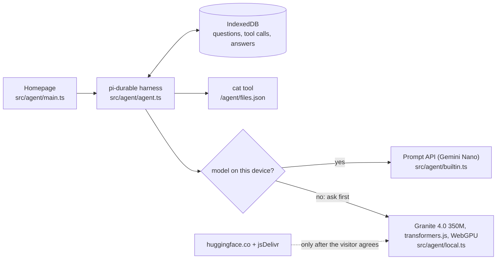

# dontpanicv.com

A static Astro site on Cloudflare. The headline of the homepage is a prompt box: a language model on the visitor's own device answers what they type, from files about V. The answer to the question the headline shows by default is written out under it, so the page works without any model. There is no backend and no AI service.

## The on-device agent

**Which model.** The page uses a model that is already on the device when there is one. As of November 2026 only desktop Chrome (148 and later) gives pages one by default: Gemini Nano, through the Prompt API (`LanguageModel`). Edge has the same API behind a flag; Safari, Firefox and every mobile browser expose nothing. In those, a short bar under the headline asks for permission to download IBM Granite 4.0 H 350M (244 MB, Apache-2.0), which then runs with transformers.js on WebGPU, or on the CPU without it. Nothing is downloaded before the visitor clicks.

**Why that model.** It is the smallest one that still answered from a file correctly (`npm run eval:models`): SmolLM2 135M (118 MB) rambled, LFM2.5 350M (255 MB) got 8 of 14 questions, Granite got 13.

**A turn is two steps** (`src/agent/route.ts`): choose up to two files, then answer with them in the prompt.
- Gemini Nano chooses the files itself. The shipped API has no tool calls, so its reply is constrained to a JSON list of file paths.
- The small model can't choose (2 of 14 right), so a keyword search over the files chooses for it. The trace says which of the two picked each file.
- Either way the choice becomes a real `cat` tool call that pi-durable runs and stores.

**Where the prompt box sits.** Until something is asked it is the headline. After that the first question stays as the headline and the box moves under the latest answer (CSS only: `.top:has(#followups:not(:empty))` in `trace.css`). "Start over" forgets the conversation and brings the headline back.

**Durability.** The loop is [pi-durable](https://www.npmjs.com/package/@earendil-works/pi-durable) on IndexedDB. Every question, tool call and answer is committed before it shows, so a reload or a closed tab resumes the conversation. One tab owns it at a time (Web Locks). Each conversation has its own database; starting over moves to a new one rather than waiting for a delete.

**The files** the agent reads are built from `src/data/profile.ts` and the posts by `src/lib/agent-files.ts`. Each has an `about` line: the model sees it in the file list and the search weighs it most, so it holds the words a visitor would use.

## Commands

Run from `astro/`:

| Command | Action |
| :-- | :-- |
| `npm install` | Install dependencies |
| `npm run dev` | Dev server at `localhost:4321` |
| `npm run build` | Build to `./dist/` |
| `npm run preview` | Serve the build locally |
| `npm test` | Self-check of the prompts and the file search |
| `npm run eval:page` | The homepage agent end to end in Chrome: download bar, answer, reload mid-answer. Needs `npm run dev` |
| `npm run eval:models [name...]` | Real questions against the shipped model, or against the candidates named in `evals/models.mjs` |
| `npm run deploy` | Build and deploy to Cloudflare (`cf deploy`) |

The evals start a throwaway Chrome profile (kept under the system temp folder, or `PROFILE=...`) and download the model into it on first run.

## Files

| Path | What it is |
| :-- | :-- |
| `src/pages/index.astro`, `src/components/home/` | the homepage: headline prompt, written answer, the files as cards, context window and model |
| `src/agent/main.ts` | finds a model or asks to download one; renders the live run |
| `src/agent/agent.ts` | pi-durable harness, the `cat` tool, the pi-ai provider |
| `src/agent/route.ts` | prompts, file search, transcript parsing (pure, tested) |
| `src/agent/builtin.ts` | the browser's Prompt API |
| `src/agent/local.ts` | the downloaded model on transformers.js |
| `src/agent/models.ts` | the model spec and what a backend looks like |
| `src/lib/agent-files.ts` | the files the agent can read |
| `src/data/profile.ts` | bio, projects, CV, contact |
| `src/styles/trace.css` | all styles |
| `scripts/pixel-mark.mjs` | redraws the logo on a pixel grid for the header and favicon |
